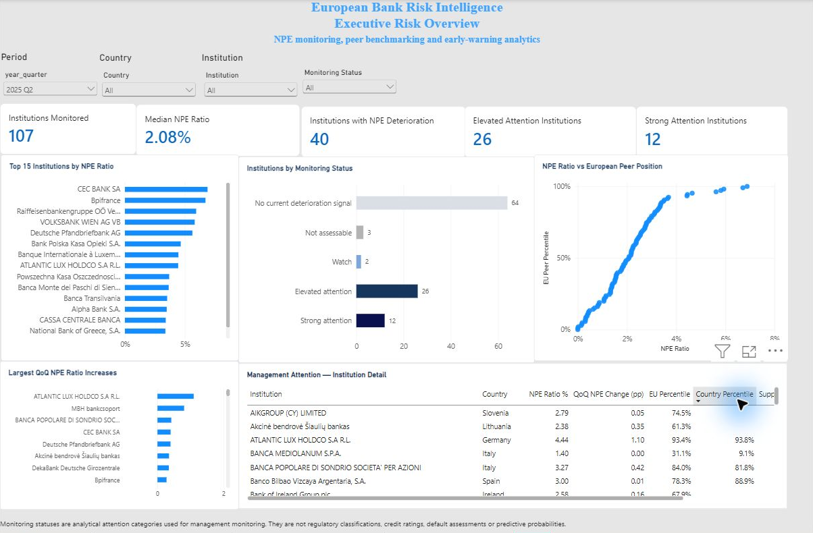

# European Bank Risk Intelligence & Automated Reporting Platform

**From official banking disclosures to explainable management monitoring.**

Banking analysts need to reconcile scattered disclosures, compare institutions fairly and distinguish a worsening ratio from missing data. This portfolio project turns the EBA 2025 Transparency Exercise into a repeatable Python workflow and three Power BI report pages, covering asset quality and capital adequacy.

The result is a historical proof of capability for risk and reporting teams: **Ratio → Benchmark → Trend → Monitoring**, with traceable source definitions and separate validation scripts. It is not a live production service.



*Genuine Power BI report capture, 27 October 2026. Reporting period: 2025 Q2; all countries and institutions. Source: European Banking Authority, 2025 EU-wide Transparency Exercise; calculations and report by QuantRisk Analytics. Attention categories guide analytical review and are not credit ratings or regulatory judgments.*

## What the analysis shows

| 2025 Q2 measure | NPE: asset quality | CET1: capital |
|---|---:|---:|
| Individual institutions with a ratio | 107 | 119 |
| Unweighted median ratio | 2.08% | 18.00% |
| Institutions with a valid consecutive-quarter comparison | 104 | 111 |
| Institutions showing direct deterioration | 40 / 104 (38.5%) | 55 / 111 (49.5%) |
| Strong attention, a subset of direct deterioration | 12 of 40 | 21 of 55 |
| Institutions without a valid comparison | 3 | 8 |

An NPE increase or CET1 decrease activates direct deterioration. A strong-attention signal also requires persistent deterioration and at least one worsening eligible peer position. These findings identify where to investigate; they do not establish regulatory breaches or predict defaults.

The two risk modules cover different populations. Medians are unweighted, and quarterly populations can change. Missing comparisons remain unavailable; they are not treated as evidence of stability.

## What was built

- **Two analytical facts:** 648,951 credit-risk records and 91,277 other-template records. These are disclosure observations, not banks or transactions.
- **Eight analytical marts:** ratio, benchmark, trend and monitoring for each of NPE and CET1, covering **2024 Q3–2025 Q2**.
- **Transparent controls:** source reconciliation, unique analytical grain, peer-population eligibility, genuine quarterly adjacency and independent reconstruction of monitoring rules.
- **Three report pages:** Executive Overview, Asset & Credit Quality and Capital Adequacy. [View the dashboard gallery and reading guide](docs/dashboard.md).


Implemented with Python, Polars, Pandas for Excel reference ingestion, Parquet and Power BI. Scheduled refresh, automatic report distribution and a deployed customer service remain future work.

## Evidence and reproduction

The publication review on **27 October 2026** reran 15 validators. All finished without blocking failures. The analytical fact checks passed **82/82** and **90/90**, cross-fact checks **18/18**, and monitoring checks **49/49 NPE** and **53/53 CET1**. Three upstream validators retain documented source-data warnings. These are internal checks, not external certification. [Read the validation evidence and limitations](docs/validation.md).

Download the four official source files, install the tested dependencies and run:

```sh
python -X utf8 src/validate_environment.py
python -X utf8 src/run_pipeline.py all
```

The build writes generated outputs locally; raw data and generated datasets are not distributed here. [Follow the setup, source-file layout and reproduction guide](docs/reproduction.md).

## Explore the project

| Resource | Purpose |
|---|---|
| [Project scope](PROJECT_CHARTER.md) | Intended users, delivered scope and boundaries |
| [Architecture](docs/architecture.md) | Data flow, analytical grain and source-to-KPI mapping |
| [Methodology](docs/methodology.md) | Ratio definitions, peer rules, trends and monitoring |
| [Validation](docs/validation.md) | Executed checks, warnings and known limitations |
| [Dashboard guide](docs/dashboard.md) | Genuine screenshots and a short demo route |
| [Reproduction](docs/reproduction.md) | EBA provenance, dependencies and execution order |
| [Transformation scripts](src/transformation/) | The implemented data pipeline |
| [Validation scripts](src/validation/) | Read-only checks against saved outputs |

The report files themselves are not distributed in this initial portfolio. The public repository reproduces the analytical pipeline; screenshots demonstrate the locally built Power BI report.

## About QuantRisk Analytics

**ANALYSE → AUTOMATE → TRAIN**

QuantRisk Analytics is a proposed Luxembourg-based, founder-led analytics, reporting-automation and professional-training consultancy. This project demonstrates the ANALYSE and AUTOMATE capabilities behind a service-led model. Customer demand, pricing and pilot engagements remain to be validated; technical evidence is not commercial traction.

Source attribution and reuse information: [EBA data provenance](docs/reproduction.md#data-provenance-and-reuse). This project is independent of the EBA and is not endorsed by it.
