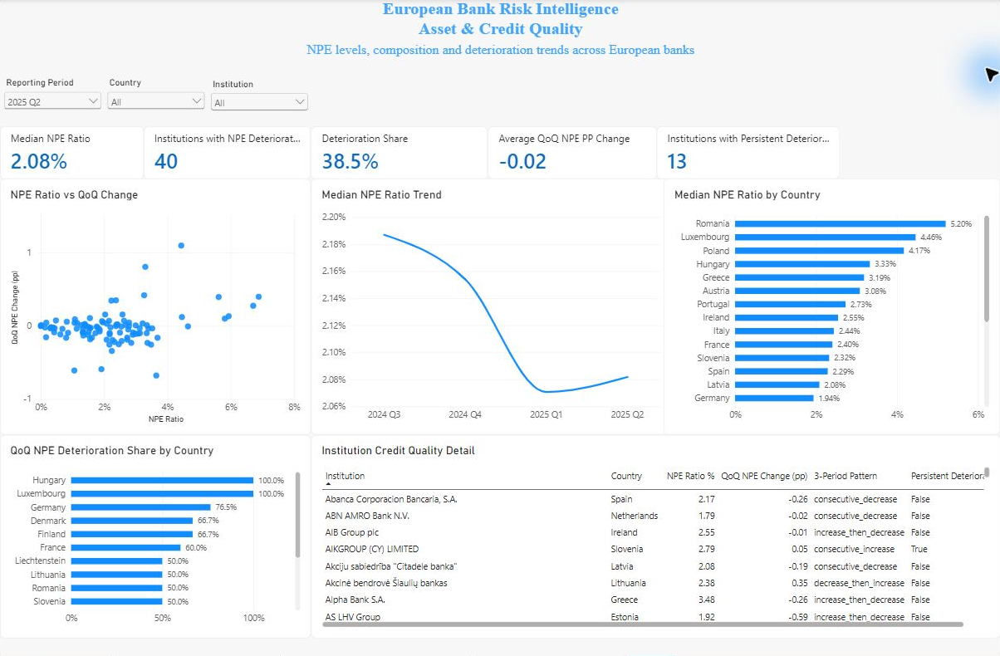
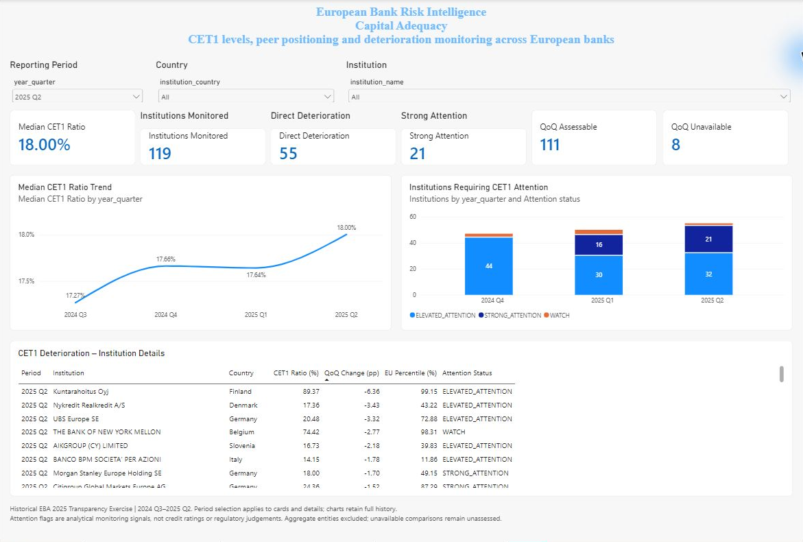

# Dashboard gallery and reading guide

These are genuine captures of the locally built Power BI report on **27 October 2026**, cropped to the report canvas. Each shows **2025 Q2, all countries and all institutions**. Data source: European Banking Authority, 2025 EU-wide Transparency Exercise; calculations and reporting by QuantRisk Analytics. No values were visually fabricated or edited.

## Executive Overview

The page connects current NPE levels, quarterly deterioration, peer position and institution-level review. Its 40 deteriorating institutions comprise 2 WATCH, 26 ELEVATED_ATTENTION and 12 STRONG_ATTENTION cases. There are 104 assessable institutions out of 107; the three unavailable comparisons are separate from the 64 cases without a current deterioration signal.

## Asset & Credit Quality

The page shows NPE levels, quarterly changes, country summaries and three-period patterns. The 38.5% deterioration share uses **40/104 assessable institutions**. The 13 persistent-deterioration cases need not equal the 12 strong-attention cases: the strong category also requires a peer-relative signal. Country charts describe the available sample; a 100% share can represent a small group and is not a country-wide conclusion. The median trend uses changing quarterly populations, not a fixed cohort.

## Capital Adequacy

The page makes comparison coverage explicit: **119 institutions, 111 assessable and 8 unavailable**. The 55 direct deterioration cases include 21 strong-attention cases. Its detail table shows the institution, quarter, CET1 level, change in percentage points, European percentile and attention status.

Reporting-period selection applies to the capital cards and detail table while the historical charts retain all quarters. Country and institution selections affect those charts. A blank or `--` assessable card in the first available quarter indicates no valid comparisons; zero flags in that situation do not mean zero risk.

## A short live demonstration

1. Start with the executive page at 2025 Q2 and explain what the counts mean, including unavailable comparisons.
2. Open Asset & Credit Quality to distinguish the current ratio, quarterly movement and persistent deterioration.
3. Open Capital Adequacy and show the 111/8 coverage split before discussing the 55 deterioration flags.
4. Select Austria and BAWAG Group AG on Capital Adequacy. Previously checked 2025 Q2 values are 12.55% CET1, one deteriorating institution and one strong-attention institution. Read the detail row alongside the trend.
5. Select 2024 Q3 to explain missing prior history, then return to 2025 Q2 / all countries / all institutions.

The three pages were visually reviewed, and focused capital filter tests passed. Exhaustive cross-filter testing and export legibility remain open. Tables are scrollable; screenshots show only the currently visible rows and columns. The report file is not part of this public release. See [methodology](methodology.md) and [validation](validation.md) for interpretation and acceptance boundaries.
